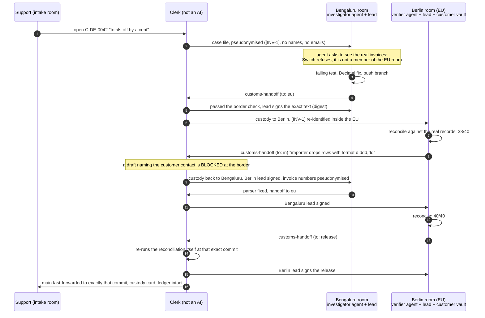

# Customs

**Let AI work cross your organisation's borders, while the data and the authority stay where they belong.**
Built on [Switch](https://github.com/sandbox-quantum/switch).

> Flip the Switch hackathon, Track 01 (Best Business Workflow). Demo video: _link to be added_.
> The full narrative, act by act, is in [docs/STORY.md](docs/STORY.md).

## The problem

AI agents are teammates now. But every real organisation has borders that agents either ignore or stop at:

- **Data:** EU customer data stays in the EU, Indian payment data stays in India, and client A's files never
  reach client B's team.
- **Authority:** only certain people may approve certain work.
- **Time:** the person allowed to say "yes" is asleep.

One agent that does everything would need every permission at once. So teams either over-share access or do
the work by hand.

## The idea

**Put each team's agents inside its own jurisdiction, and let work (not data) cross between jurisdictions
through a border enforced in code.**

On Switch, every part of that already exists:

| Concept | Switch primitive |
|---|---|
| Jurisdiction | a **room**. Membership is enforced by the server. |
| Who owns the task right now | an **exclusive role** in that room (one holder at a time) |
| The border | the **Customs clerk**: a custom agent, the only member of every room. Deterministic, not an AI. |
| A crossing | a structured handoff, a person's signature on the exact text, and a hash-chained ledger entry |
| The whole setup | one **template** |

Jurisdictions, routes, approvers and what counts as protected data are configuration. The rest of this page is
**one example**.

---

## The example: one ticket, two jurisdictions

An EU customer, Brauhaus Lindenhof GmbH, writes in. Invoice totals in Ledgerly, our invoicing library, are
off by a cent against their books, and their auditor wants it fixed before the VAT return. It is 05:00 in
Berlin and 09:30 in Bengaluru.



The second bug only shows up in the real data. German ERP exports write `1.234,50`, and Ledgerly's importer
silently drops those rows. Bengaluru could not have found it from a pseudonymised case file. Berlin could not
have fixed it without the code context. The ticket needs both regions, and the border is what makes that safe.

In five steps, each adding one idea:

1. **A signed crossing.** Bengaluru hands the ticket to Berlin; the Bengaluru lead signs; custody moves.
2. **The wall.** Asked to look at the real invoices, the Bengaluru agent is refused by Switch itself.
3. **The border check.** Identifiers are pseudonymised, and a draft containing a person's details is blocked.
4. **The round trip.** Real data shows 38/40; the ticket goes back, is fixed, and comes back at 40/40.
5. **A provable release.** The clerk re-verifies, a person signs, exactly that commit merges, and the ledger proves it.

## What stops working without Switch

| Without Switch | With Switch |
|---|---|
| Three agents on different machines and vendors have no shared place to talk | Agents and people share rooms in the chat they already use (Mattermost, Slack, Teams, Discord, Telegram) |
| "Keep EU data in the EU" is a sentence in a prompt | Room membership is checked by the server: the Bengaluru agent's `read_context` on the EU room is refused |
| "Who owns this right now?" lives in someone's head | Exclusive room roles (`investigator`, `verifier`): one holder at a time, and the clerk accepts handoffs only from the current holder (read from Switch's role leases) |
| Approvals are a thumbs-up anyone could fake | The clerk checks the signer is a person (not an agent) and is that region's named approver |
| Setup is a wiki page | One template deploys the group, three rooms, links, both agents, roles and kickoffs |

## How the border holds

The defences are layered. Each one is enforced in code or by the Switch server, never by asking a model nicely.

1. **Switch membership** (server-enforced). Each regional agent is a member of one room only. Switch refuses
   reads of rooms an agent is not in. The clerk is the only member of every room.
2. **Custody** (clerk). A ticket is in exactly one region's custody. Only the holder of that region's
   exclusive role can hand it on, and only along configured routes.
3. **The border check** (clerk, deterministic). Text leaving a data-resident region is scanned against the
   customer registry and patterns for personal data: names, emails, phones, IBANs, VAT IDs, addresses.
   - If any is found, the handoff is **blocked, not repaired**. The refusal names the field and the kind of
     data, never the value.
   - Identifiers (invoice numbers, the customer's name) are **pseudonymised** on the way out (`[INV-3]`) and
     re-identified only on the way back in. The mapping never leaves the clerk.
4. **Signatures** (clerk). Every crossing needs a person from the region the work is leaving. Agents can't
   sign, and neither can people outside the approver list. Signatures are pinned to the digest of the exact
   text that will cross, and are single-use.
5. **Release** (clerk + git). Before anyone is asked to sign, the clerk reconciles the requested commit
   against the vault itself, in a fresh export of that commit. After the Berlin lead signs, it fast-forwards
   `main` to exactly that commit, or refuses if `main` moved.
6. **Ledger** (clerk). Every decision, including every refusal, is appended to a hash-chained ledger.
   Editing, reordering or deleting an entry breaks the chain, and `@customs-clerk verify-ledger` says where.

The clerk is also durable. Decisions are saved before they're announced, through an outbox, so a crash never
duplicates a handoff or loses an approval request.

## Run it

**Requirements:** Switch Console, Docker, Python 3.11+, git, and one or two coding agents (Claude Code,
Codex, OpenCode, Antigravity or Cursor). Switch bundles Mattermost, so you don't need a company chat workspace.

```bash
git clone <this repo> && cd customs

# 1. Regional workspaces: shared origin, Bengaluru clone, Berlin clone + customer vault
python scripts/setup_regions.py            # creates ~/customs-regions

# 2. Register the clerk (registration key: Switch Gateway -> API Keys)
python -m customs register --base-url http://localhost:<bridge port> --registration-key <key>

# 3. In Switch Console: Templates -> import switch/customs.template.yaml -> run it
#    (pick the Berlin lead's chat account; the defaults point at ~/customs-regions)

# 4. Put your two approvers' chat usernames into config/customs.toml, then:
python -m customs check                    # rooms, members, who holds which role
python -m customs run                      # the clerk
```

Then, in `customs-intake`:

```
@customs-clerk open C-DE-0042 invoice totals off by a cent
```

Other commands: `@customs-clerk status`, `@customs-clerk ledger TKT-0001`, `@customs-clerk verify-ledger`.
Leads sign with `approve H-3` or `reject H-3 <reason>`.

### Tests

```bash
pip install pytest
python -m pytest -q          # 37 tests: border, custody, signatures, ledger tampering, real-git release, crash recovery
cd ledgerly && python -m pytest -q   # the demo app's own (passing, but incomplete) tests
```

## Repository map

| Path | What |
|---|---|
| `customs/desk.py` | Every rule, as a pure state machine (no I/O) |
| `customs/redact.py` | Personal-data detection, pseudonymisation, re-identification |
| `customs/handoff.py` | The `customs-handoff` block and its validation |
| `customs/ledger.py` | Hash-chained custody ledger |
| `customs/services.py` | Vault case files; git origin (exists / verify at commit / fast-forward merge) |
| `customs/clerk.py`, `switch_client.py` | The Switch agent process (stdlib only, polls the agent protocol) |
| `switch/customs.template.yaml` | One-shot Switch deployment |
| `ledgerly/` | The demo codebase, with two real bugs |
| `fixtures/` | Synthetic EU customer vault and its generator (all data is fake) |
| `tools/verify_vault.py` | Berlin's reconciler: shareable summary on stdout, full report stays local |

## Honest limits

- **Regions are simulated on one machine** in the demo. The Switch boundary (room membership) is real. The
  filesystem boundary between `~/customs-regions/in` and `eu` is a guard rail (Claude Code deny rules), not
  isolation. In production the workspaces are different machines (Switch remote hosts).
- **Detection is deterministic, not omniscient.** The clerk catches what the customer registry knows plus
  common patterns. A person's name it has never seen, written in free text, would get through. That's why
  every crossing also needs a human signature on the exact text.
- **The clerk polls** the agent protocol every 2 seconds instead of holding an event stream open. That keeps
  it simple and restart-safe.
- **Business amounts are treated as shareable** once identifiers are pseudonymised. Personal data is not.
  That's a policy choice, made explicit in `customs/redact.py`.
- All customer data in `fixtures/` is synthetic.

## Built with AI assistance

Built with Claude Code. Every rule, test and design decision here was reviewed by the author, who can explain
each one.
