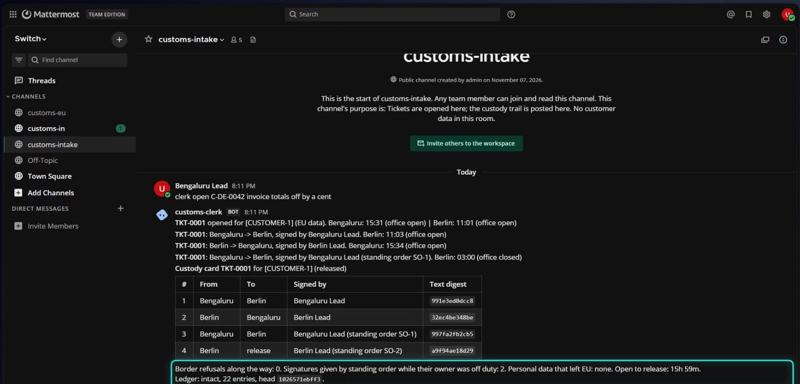

# Customs

**Follow-the-sun AI work on [Switch](https://github.com/sandbox-quantum/switch): it keeps moving while your
people sleep, and customer data stays in its region.**

> Flip the Switch hackathon, Track 01 (Best Business Workflow).
> **Demo video (2:54): <https://youtu.be/oU3Dtn7tzgg>**. One live take in a real Switch + Mattermost workspace.
> The full narrative, act by act, is in [docs/STORY.md](docs/STORY.md). Blog post for first-time Switch users:
> [docs/BLOG.md](docs/BLOG.md).



## The problem

Global teams spread across regions, for example Bengaluru and Berlin, 4.5 hours apart. AI agents can work
around the clock, but two borders stop the work:

1. **Authority sleeps.** The person who must approve a release, a customer reply or a production change is
   offline. The agent's work piles up waiting for a "yes", and the time difference costs a day.
2. **Access is regional.** Data residency rules (GDPR in the EU, RBI localisation in India, client
   confidentiality everywhere) mean an EU customer's data may only be handled in the EU. A Bengaluru engineer,
   and an agent working with that engineer's access, is not allowed to see it, however capable it is.

Teams fail in one of two directions. They either **give the agent everything** (all access, plus auto-approve
so nobody has to wake up), or they **keep a human in every loop** and the agent waits all night.

## The idea

**Each region's agents live in their own room. Work, not data, crosses between rooms through a border
enforced in code. Authority crosses time zones as a bounded, expiring delegation, never as a blank cheque.**

| Concept | On Switch |
|---|---|
| A region | a **room**. Membership is enforced by the Switch server. |
| Who owns the task right now | an **exclusive role** in that room: one holder at a time |
| The border | the **Customs clerk**: a custom Switch agent, the only member of every room. Deterministic, not an AI. |
| A crossing | a structured handoff, a person's signature on the exact text, a hash-chained ledger entry |
| Authority while asleep | a **standing order**: "release TKT-0001 only if your own check passes, once, until 09:00" |
| The whole setup | one **template** |

Regions, routes, approvers, office hours and what counts as protected data are all configuration. Below is
**one example**.

---

## The example: an EU customer's bug, fixed overnight

An EU customer, Brauhaus Lindenhof GmbH, writes in. Invoice totals in Ledgerly, our invoicing library, are off
against their books, and their auditor wants it fixed before the VAT return.

This is exactly what the demo video shows, recorded in one live run:

| Act | Berlin time | What happens | Border |
|---|---|---|---|
| 1. A masked case file | 11:01 | Support opens the ticket. The clerk hands Bengaluru a case file with every name, phone number and invoice number already masked. | access |
| 2. The wall | 11:02 | Asked to look at the real invoices, the Bengaluru agent is **refused by Switch itself** (`403: Agent is not a member of this room`). | access |
| 3. A signed crossing | 11:03 | Bengaluru fixes the rounding bug and hands it to Berlin. The Bengaluru lead signs the exact text, custody moves, and the invoice numbers turn back into real ones only inside Berlin. | authority |
| 4. Real data | 11:04 | Berlin reconciles against the real records: **38/40**. It sends back the format that breaks the importer, never the values, and the clerk masks the invoice numbers on the way out. | access |
| 5. Night falls | 18:05 | Both leads leave **standing orders** before going offline: "hand the next fix to Berlin" and "release TKT-0001 only if your own check passes, until 09:00". | authority |
| 6. While everyone sleeps | 03:00 | The second fix lands: **40/40**. The clerk re-verifies that exact commit itself, signs under the Berlin lead's standing order, and fast-forwards `main`. | both |
| 7. Morning, and proof | 09:01 | "Good morning, Berlin. While you were away: TKT-0001 was released." Custody card, then an intact ledger, then a tamper test. | proof |

Had any reply named the customer's contact, the clerk would have **blocked it at the border** and said where,
without repeating the value. In the recorded run the agents' replies were clean, so the custody card shows 0
refusals. The block is covered by the tests, and [docs/DEMO_RUNBOOK.md](docs/DEMO_RUNBOOK.md) shows how to
trigger it live.

The second bug only shows up in the real data. German ERP exports write `1.234,50`, and Ledgerly's importer
silently drops those rows. Bengaluru could not have found it from a pseudonymised case file, and Berlin could
not have fixed it without the code context. The ticket needs both regions, and both time zones.

## What stops working without Switch

| Without Switch | With Switch |
|---|---|
| Agents on different machines and vendors have no shared place to work | Agents and people share rooms in the chat they already use (Mattermost, Slack, Teams, Discord, Telegram) |
| "Keep EU data in the EU" is a sentence in a prompt | The Bengaluru agent's `read_context` on the EU room is refused by the server |
| "Who owns this right now?" lives in someone's head | Exclusive room roles. The clerk accepts handoffs only from the current holder, read from Switch's role leases |
| Approvals are a thumbs-up anyone could fake | Signers must be people (not agents) and that region's named approvers |
| Setup is a wiki page | One template deploys the group, three rooms, links, both agents, roles and kickoffs |

## How the borders hold

Everything below is enforced in code or by the Switch server, never by asking a model nicely.

**Access**
1. **Switch membership.** Each regional agent is a member of one room only, and Switch refuses reads of other
   rooms. The clerk is the only member of every room.
2. **Custody.** A ticket is in exactly one region's custody. Only the holder of that region's exclusive role
   can hand it on, along configured routes.
3. **The border check.** Text leaving a data-resident region is scanned against the customer registry and
   patterns for personal data (names, emails, phones, IBANs, VAT IDs, addresses).
   - If any is found, the handoff is **blocked, not repaired**. The refusal names the field, never the value.
   - Identifiers (invoice numbers, the customer's name) are **pseudonymised** on the way out (`[INV-3]`) and
     re-identified only inside the resident region.

**Authority**
4. **Signatures.** Every crossing needs a person from the region the work is leaving, and every release needs
   one from the resident region. Agents can't sign. Signatures are pinned to the digest of the exact text, and
   single-use.
5. **Standing orders.** Before going off duty, an approver can delegate one signature.
   - It is scoped to a ticket and an action, expires (24 h at most), and is used once.
   - It applies only when its condition holds. For a release, the condition is that the clerk's own
     reconciliation of that exact commit passes.
   - It never overrides a block, and it's revocable.
   - It's ledgered as "signed by berlin-lead (standing order SO-2)".
6. **Office hours.** Requests to a closed office say when its people are back, and agents are told to keep
   working rather than wait. Closing notes suggest a standing order. Morning briefings list what happened
   overnight and what waits for a signature.

**Release and proof**
7. **Independent verification.** Before any person or standing order may sign a release, the clerk reconciles
   the requested commit against the vault itself, in a fresh export. Then it fast-forwards `main` to exactly
   that commit, or refuses if `main` moved.
8. **Ledger.** Every decision, every refusal and every use of delegated authority is hash-chained.
   `clerk verify-ledger` names the first tampered entry.

The clerk is also durable. Decisions are saved before they're announced, through an outbox, so a crash never
duplicates a handoff or loses a signature request.

## Run it

**Requirements:** Switch Console, Docker, Python 3.11+, git, and one or two coding agents (Claude Code,
Codex, OpenCode, Antigravity or Cursor). Switch bundles Mattermost, so you don't need a company chat workspace.

```bash
git clone https://github.com/Vidhaankhare16/customs && cd customs

# 1. Regional workspaces: shared origin, Bengaluru clone, Berlin clone + customer vault
python scripts/setup_regions.py            # creates ~/customs-regions

# 2. Register the clerk with your Switch server
python -m customs register --base-url http://localhost:<agent bridge port> --registration-key <key>

# 3. In Switch Console: Templates -> import switch/customs.template.yaml -> run it
#    (If the template form can't create agents on your machine, create in-investigator and eu-verifier under
#    Your Agents -> New agent, using switch/agents/*.md as instructions, then run switch/customs-rooms.template.yaml.)

# 4. Put your two approvers' chat usernames into config/customs.toml, then:
python -m customs check                    # rooms, members, who holds which role
python -m customs run                      # the clerk
```

**People, in the chat:**

| Command | Where | What |
|---|---|---|
| `clerk open C-DE-0042 <problem>` | intake | open a ticket |
| `approve H-3` / `reject H-3 <reason>` | the region the work leaves | sign a crossing |
| `clerk standing-order release TKT-0001 until 09:00` | your region's room | delegate one signature while you're away |
| `clerk revoke SO-2`, `clerk orders` | anywhere | manage standing orders |
| `clerk status`, `ledger TKT-0001`, `verify-ledger` | anywhere | see state and proof |
| `clerk time eu 18:05` | anywhere | **demo only**: move the desk clock (ledgered) |

### Tests

```bash
pip install pytest
python -m pytest -q          # 51 tests, offline, about 20 s: border, custody, signatures, standing orders,
                             # briefings, ledger tampering, real-git release, crash recovery
cd ledgerly && python -m pytest -q   # the demo app's own (passing, but incomplete) tests
```

## Repository map

| Path | What |
|---|---|
| `customs/desk.py` | Every rule, as a pure state machine (no I/O) |
| `customs/redact.py` | Personal-data detection, pseudonymisation, re-identification |
| `customs/handoff.py` | The `customs-handoff` block and its validation |
| `customs/ledger.py` | Hash-chained custody ledger |
| `customs/services.py` | Vault case files; git origin (exists / verify at commit / fast-forward merge) |
| `customs/clerk.py`, `switch_client.py` | The Switch agent process (stdlib only, polls the agent protocol) |
| `switch/customs.template.yaml` | One-shot Switch deployment |
| `ledgerly/` | The demo codebase, with two real bugs |
| `fixtures/` | Synthetic EU customer vault and its generator (all data is fake) |
| `tools/verify_vault.py` | Berlin's reconciler: shareable summary on stdout, full report stays local |

## Honest limits

- **Regions are simulated on one machine** in the demo. The Switch boundary (room membership) is real. The
  filesystem boundary between `~/customs-regions/in` and `eu` is a guard rail (Claude Code deny rules), not
  isolation. In production the workspaces are different machines (Switch remote hosts).
- **The night is simulated too.** In demo mode a person can move the desk clock. Every move is a ledger entry,
  and the setting is off by default outside the demo config.
- **Detection is deterministic, not omniscient.** The clerk catches what the customer registry knows plus
  common patterns. An unknown name in free text would get through, which is why every crossing also needs a
  signature on the exact text.
- **Standing orders are only as good as their condition.** That's why a release can only be delegated when the
  clerk verifies it independently.
- **The clerk polls** the agent protocol every 2 seconds instead of holding an event stream open: simpler and
  restart-safe.
- **The demo's two people are one person.** In the video, "Bengaluru Lead" and "Berlin Lead" are two chat
  accounts played by the author. The agents' and the clerk's messages are live and unedited. Waiting time is cut.
- All customer data in `fixtures/` is synthetic.

## Built with AI assistance

Built with Claude Code. Every rule, test and design decision here was reviewed by the author, who can explain
each one.
