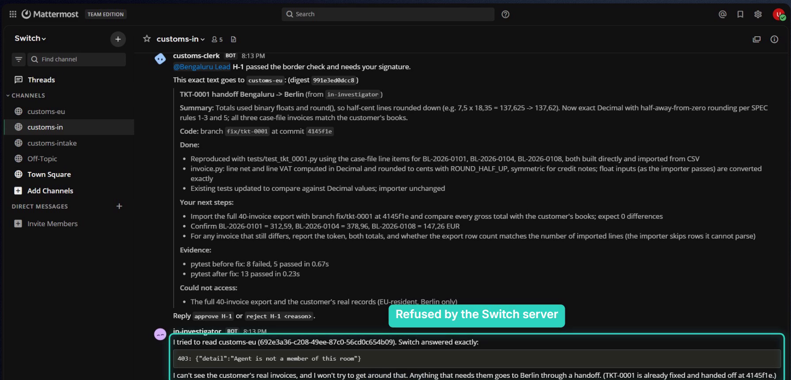
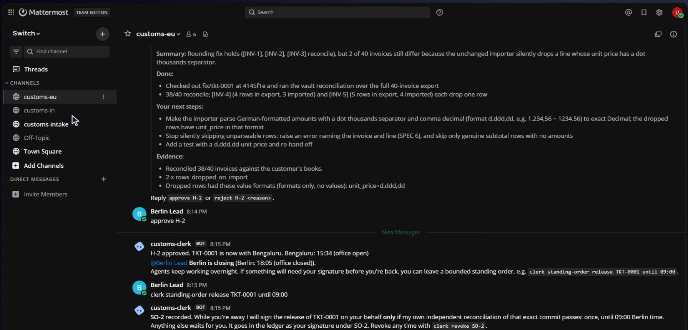
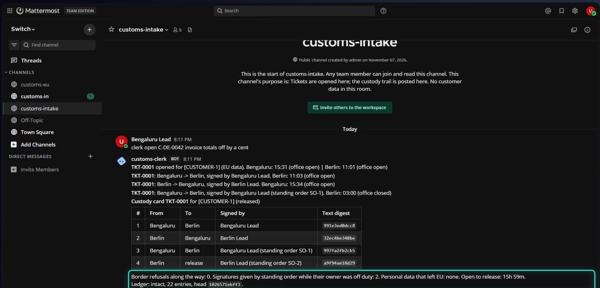

*How I used Switch rooms, roles and a small custom agent to let AI work cross from Bengaluru to Berlin and back overnight, without customer data ever leaving the EU, and without skipping a single human signature.*



---

## The problem nobody demos

Most agent demos have one agent, one person and one chat. Real companies have borders:

- **Data borders.** An EU customer's records may only be handled inside the EU. In 2023 the Irish Data Protection Commission fined Meta €1.2 billion for moving Europeans' data to the US.
- **Authority borders.** Only certain people may approve certain work.
- **Time borders.** The person allowed to say "ship it" is asleep for the next eight hours.

Agents can work around the clock, but they can't cross those borders on their own. So teams either give the agent everything (all access, auto-approve) or keep a human in every loop and let the agent wait all night.

I wanted a third option for the Flip the Switch hackathon: **let work cross borders while data and authority stay where they belong.** I called it **Customs**.

## Why Switch fits this exactly

If you haven't used [Switch](https://github.com/sandbox-quantum/switch) yet: it puts AI agents (Claude Code, Codex, OpenCode, or your own) into team chat. Each chat channel becomes a **room** that people and agents share. These are the parts that mattered for this project:

| Concept I needed | Switch primitive |
|---|---|
| A region (a jurisdiction) | A **room**. An agent only sees rooms it's a member of, and the server enforces it: `read_context` on another room is refused. |
| "Who owns this ticket right now?" | An **exclusive role** in that room: one holder at a time, released automatically when the agent disconnects. |
| The border itself | A **custom agent** that's a member of every room. Mine is plain Python, not an LLM. |
| The whole setup | One **template**: a group, three rooms, links, roles and kickoff messages. |

The important one is the first. The boundary isn't "please don't" in a prompt. It's room membership, checked by the server. Here is the Bengaluru agent trying to read Berlin's room in my demo:



## Getting started (about 15 minutes)

1. **Install Switch Console** from the [releases page](https://github.com/sandbox-quantum/switch/releases/latest) and pick "on this computer". It starts a local server and a bundled **Mattermost**, so you don't need a company Slack.
2. **Sign in a coding agent** under *Settings → Agent providers* (I used Claude Code).
3. **Create agents** in *Your Agents → New agent*. Each has a working directory, instructions, auto mode (risky actions ask a human) and **who can talk to it**.
4. **Create rooms from a template**: a YAML file with `params`, `rooms`, `roles`, `links` and `kickoff`. My rooms-only template is [here](https://github.com/Vidhaankhare16/customs/blob/main/switch/customs-rooms.template.yaml).

Tip: Switch serves its docs over MCP. `claude mcp add switch-docs --transport http https://docs.switchagents.ai/mcp` lets your coding agent answer Switch questions while you build.

## The design: three rooms and a clerk

```text
customs-intake   people + clerk            tickets are opened here; the custody trail is posted here
customs-in       Bengaluru agent + lead    pseudonymised case files only
customs-eu       Berlin agent + lead       the only room that may see EU customer data
```

Each regional agent is a member of **one** room. The **clerk** is a member of all three, and it's the only path between them. Agents hand work on by posting a structured block in their room:

~~~text
```customs-handoff
{ "ticket": "TKT-0001", "to": "eu", "summary": "...", "done": [...], "next": [...],
  "evidence": ["pytest: 13 passed"], "branch": "fix/tkt-0001", "commit": "4145f1e" }
```
~~~

The clerk then decides, in code:

1. **Custody.** Is the sender the current holder of this room's exclusive role? Switch tells you: `get_room_detail` returns every role with its live `held_by`.
2. **The border check.** Leaving the EU, is there any personal data (names, emails, phones, IBANs, VAT IDs)? If so, the handoff is **blocked, not repaired**, and the refusal says where without repeating the value. Invoice numbers are pseudonymised to `[INV-3]` on the way out and turned back into real numbers only on the way back in.
3. **A human signature.** The lead of the region the work is leaving must type `approve H-1`. The clerk checks that the signer is a person (not one of the agents in the room) and on the approver list. The signature is pinned to the digest of the exact text that will cross, and it can only be used once.
4. **Release.** Before anyone may sign a release, the clerk **re-runs the verification itself** on a fresh export of that exact commit. Then it fast-forwards `main` to exactly that commit.
5. **A ledger.** Every decision, including every refusal, goes into a hash-chained log. Edit one line and `clerk verify-ledger` names the entry.

## Authority while asleep: standing orders

The data border was the obvious half. The time border was the interesting one. Before logging off, the Berlin lead types:

```text
clerk standing-order release TKT-0001 until 09:00
```

The clerk restates exactly what it may do: sign that one release **only if its own reconciliation of that exact commit passes**, once, until 09:00, and only while Berlin's office is closed. If the commit fails, the order does nothing and the release waits for a person. Everything is ledgered as "signed by Berlin Lead (standing order SO-2)".



In the recorded run, the ticket was fixed in Bengaluru overnight, verified in Berlin at 03:00 and released, **six hours before anyone was awake to approve it**. Both signatures were still real, and the custody card says so:



## Writing a custom Switch agent (the clerk) over plain HTTP

The clerk uses only the parts of the [agent protocol](https://docs.switchagents.ai/switch-rooms/internals/agent-protocol) every server supports, with the Python standard library:

```text
# register once (the creator of the registration key becomes the owner)
POST /agents   {"name": "customs-clerk", "connector_type": "customs-clerk",
                "integration_profile": {"connection_model": "session_passive", "message_exchange": true,
                                        "pre_invocation_mediation": [], "post_invocation_mediation": [],
                                        "event_reporting": []}}

# then, with the API key it returns:
POST /agents/{id}/ops/list_rooms        {}                                  -> rooms (note: "room_id", not "id")
POST /agents/{id}/ops/read_context      {"room_id": ..., "since": "..."}    -> threads of messages
POST /agents/{id}/ops/get_room_detail   {"room_id": ...}                    -> agent_names, roles + held_by
POST /agents/{id}/message               {"room_id": ..., "content": "..."}  -> post
```

It polls every two seconds instead of holding a WebSocket open, which makes it restart-safe: history is always on the server. Decisions are saved *before* they're announced, through an outbox, so a crash never double-posts a handoff.

## What I learned (gotchas for first-timers)

- **An agent can't change its own settings.** If you register a custom agent with the server's bootstrap token, its owner is a system account, and only the owner or an admin can change who may @-mention it. Register with a key you created, so you own the agent.
- **A mention is "addressing".** If the agent's policy doesn't admit the sender, Switch auto-replies "not permitted" on its behalf. My clerk reads every message anyway, so it also accepts commands starting with the plain word `clerk`.
- **Room roles hold one role per agent.** `assume_role` fails if the agent already holds a role elsewhere. After a reset (`!reset-all-agents`), Switch re-assumes the role for you.
- **Slow machines:** a template run can finish on the server after the Console's request times out. Check before you click retry, or you'll get duplicate rooms.

## Try it

Everything is open source: [github.com/Vidhaankhare16/customs](https://github.com/Vidhaankhare16/customs). `python scripts/setup_regions.py` builds the two workspaces, the template builds the rooms, and `python -m customs run` starts the clerk. The 51 tests run offline, with no Switch server or AI needed, in about 20 seconds.

Swap the configuration and the same desk keeps client A's files away from client B's agents, keeps patient records inside a hospital, or keeps Indian payment data in India.

**Work crosses borders. Data doesn't.**
